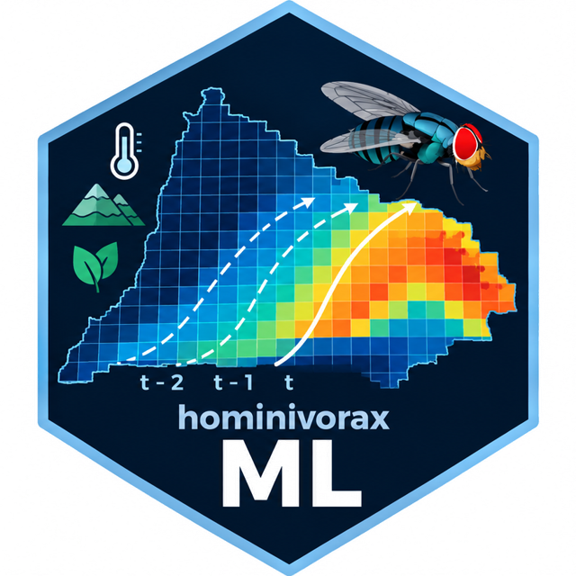

<p align="center">
  
</p>


# hominivorax-ml

Repository: [geoepi/hominivorax-ml](https://github.com/geoepi/hominivorax-ml)

`hominivorax-ml` provides a statistical machine-learning workflow for weekly
spatial prediction of recorded *Cochliomyia hominivorax* detections. The
current supported model, Structured A3, is a penalized spatiotemporal hurdle
regression combining a Bernoulli occurrence component with a zero-truncated
negative-binomial positive-count component. Spatial and temporal structure are
represented through time-varying environmental predictors, seasonality,
geographically structured host and landscape covariates, and lagged
detection-history variables describing the evolving observed invasion front.

## Current supported model: Structured A3

The frozen model has 34 predictors, penalty `0.01`, fixed theta
`0.7018903965556372`, and the exact objective `exact_joint_hurdle_nll`. It
operates on the canonical 10,037-node, 25 × 25 km weekly domain covering
Mexico and the United States south of 40°N. The authoritative specification is
in [`docs/current/model.md`](docs/current/model.md), with the frozen manifest
at [`analysis/structured_a3_evaluation/results/frozen_a3_evaluation_manifest.json`](analysis/structured_a3_evaluation/results/frozen_a3_evaluation_manifest.json).

## Project status (2026-11-22)

| Area | Current record |
|---|---|
| Supported architecture | Frozen `STRUCTURED_A3`; the original scientific training cutoff remains W16. |
| Active production artifact | W29 full fit, according to the last isolation record; the deployed tag is not established by the repository template. |
| Latest completed candidate | `STRUCTURED_A3_2026W44`; full fit complete, not production-qualified. |
| Forecast qualification | Q1 retrospective completed but target maturity is uncertified (`NOT_ASSIGNED`); independent fixed-W44 prospective qualification is pending. |
| Scientific limitations | Opportunistic reporting, unexplained source revisions, outcome maturity, frontier support, and residual spatial correlation remain limitations/diagnostics. |
| Historical decisions | A4, A5, A5B, and evaluated A6 alternatives were not selected; point proximity did not justify a new challenger. See the [decision register](docs/current/model_development_decisions.md). |
| Remaining operational blocker | Reconcile the tracked P6 W16 model contract with the W29 artifact identified as active in the latest Atlas isolation record before operational deployment. |

The detailed artifact identities and provenance are maintained in the
[canonical current-status record](docs/current/status.md).

Structured A3 is spatiotemporally informed rather than a latent
spatial-random-field or graph model. Temporal dependence is represented by
time-varying covariates, seasonality, and lagged detection history; spatial
structure is represented by geographically structured predictors and dynamic
distance-to-front/history variables.

## Model outputs

The P0–P5 descriptive full-fit workflow generates weekly occurrence
probability, conditional positive-count mean, and unconditional expected
recorded count, together with GeoTIFFs, tables, reports, and manifests. The P6
inference path is separate. Atlas products are not vendored in this repository.

## Study domain and temporal resolution

The model uses weekly node-level data on 10,037 canonical cells. The original
W16 frozen model, active W29 production artifact, W44 candidate full fit, and
retrospective/qualification evidence have separate vintages and statuses;
consult [`docs/current/status.md`](docs/current/status.md) for the canonical
table.

## Model inputs

Expected schemas, transformations, and source classes are documented in
[`docs/current/data.md`](docs/current/data.md) and
[`docs/current/predictors.md`](docs/current/predictors.md). Public code and
predictor definitions are tracked here; protected observations, large derived
rasters, and Atlas-local products remain outside Git.

## Validation status

- Development is complete and the Structured A3 specification is frozen.
- The historical exposed holdout is supported under the documented rubric.
- The W16-qualified operational contract supports 1–3 week nowcasting with the
  issue-time `E0_LAST_AVAILABLE` environmental proxy and explicit P4 support
  flags; this is prospective input construction, not a true future-environment
  forecast.
- The current descriptive full fit is not independent validation data.

Operational production functionality and scientific transfer evidence remain
separate claims. See [`docs/current/validation.md`](docs/current/validation.md),
[`docs/current/limitations.md`](docs/current/limitations.md), and the
[`model qualification summary`](docs/model_qualification_summary.md).

## Operational inference and descriptive full-fit workflows

The canonical operational inference entry point is
`analysis/p6_production_hardening/scripts/p6_production.py`. It uses the
versioned `E0_LAST_AVAILABLE` contract for horizons 1–3, retains P4 support
classes and provenance, and does not refit. The separate P0–P5 pipeline and
W44 candidate-refresh workflow have distinct purposes and roots; see the
[entrypoint inventory](docs/release/production_entrypoint_inventory.md).
The P7 publication package is generated from tracked P1–P6 artifacts with:

```text
Rscript analysis/p7_publication/scripts/build_publication_artifacts.R --repo-root .
```

See [`analysis/p7_publication/p7_prespecification.md`](analysis/p7_publication/p7_prespecification.md),
the [`publication results`](analysis/p7_publication/results/results_synthesis.md),
and [`docs/model_qualification_summary.md`](docs/model_qualification_summary.md).

## Atlas execution paths

The P0–P5 `production_fullfit` launcher fits the frozen specification once on
the accepted complete input horizon and generates descriptive fitted-period
products. It is not the P6 issue-time inference command and does not establish
prospective validation. Atlas users should review the deployment configuration
and runbook before invoking it:

```bash
bash slurm/submit_a3_pipeline.sh \
  --mode production_fullfit \
  --config /project/disease_ecology/STGNN-production-config/atlas-production.yaml
```

P0–P5 also exposes a `prospective_evaluation` mode that scores only eligible
weeks without refitting. The separately validated P6 entry point remains the
operational inference path. These commands are not interchangeable:

```bash
bash slurm/submit_a3_pipeline.sh \
  --mode prospective_evaluation \
  --config /project/disease_ecology/STGNN-production-config/atlas-production.yaml
```

An optional opaque correlation value may be supplied by an external caller for
read-only provenance. It is trimmed, captured once in
`submission_manifest.json`, and propagated unchanged through P0–P5; it does
not change the run ID, model inputs, scientific outputs, or execution policy:

```bash
CHIME_EXECUTION_ID='manual-correlation-validation-20261007' \
bash slurm/submit_a3_pipeline.sh \
  --mode prospective_evaluation \
  --config /project/disease_ecology/STGNN-production-config/atlas-production.yaml
```

The variable is optional. Unset or blank values are recorded as JSON `null`.
Embedded control characters and values longer than 256 UTF-8 bytes are
rejected. Native operators may use any opaque identifier format; no CHIME
launch or execution action is implied by recording the value.

Both P0–P5 modes are dependency-chained SLURM workflows. Use `--dry-run` to
validate configuration and print the planned chain without submitting jobs.
The W44 candidate-refresh work is a development workflow under
`scripts/run_task2e_refresh.R` and `hpc/run_task2e_refresh.sbatch`; it created
the unpromoted W44 candidate and must use its separate development root. It is
not the routine P6 inference command. Details and recovery instructions are in
[`docs/current/atlas.md`](docs/current/atlas.md).

## Repository structure

- `analysis/`: validated analysis components and compact provenance artifacts.
- `scripts/`: reusable data, model, validation, and orchestration helpers.
- `slurm/`: release-facing Atlas submission and status wrappers.
- `config/`: tracked scientific configuration and Atlas configuration example.
- `R/`, `python/`: reusable model and data-contract code.
- `tests/`: Python, R, and orchestration contract tests.
- `docs/current/`: current supported workflow documentation.
- `docs/history/`: preserved development and audit records.

## Data availability

The repository does not distribute protected observations, large derived
rasters, or Atlas production outputs. See
[`docs/current/data.md`](docs/current/data.md) for the public/private boundary
and expected schemas.

## Limitations

The model predicts recorded detections rather than organism abundance.
Detection-history predictors describe the observed reporting/invasion state;
coefficients are conditional associations rather than causal effects. See the
full limitations statement in [`docs/current/limitations.md`](docs/current/limitations.md).

The formal P0 freeze is documented in
[`docs/production_model_freeze.md`](docs/production_model_freeze.md), with the
machine-readable contract at
[`config/production_model_freeze.json`](config/production_model_freeze.json)
and the subsequent qualification sequence in
[`docs/production_qualification_plan.md`](docs/production_qualification_plan.md).

## Related projects

[`geoepi/hominivorax-geostat`](https://github.com/geoepi/hominivorax-geostat)
is a companion Bayesian joint-likelihood/geostatistical modeling workflow.
`hominivorax-ml` is the statistical machine-learning/predictive-modeling
workflow. Neither project supersedes the other.

## Development history

The release-facing documentation is intentionally not a chronological diary.
Major development records, including the original neural/GNN work, are
preserved in [`docs/history/README.md`](docs/history/README.md) and
[`docs/history/development_timeline.md`](docs/history/development_timeline.md).

## Citation / license

Citation metadata is in [`CITATION.cff`](CITATION.cff). The software is
released under the MIT License; see [`LICENSE`](LICENSE). Upstream datasets
and third-party model inputs retain their own licensing and access
requirements and are not redistributed by this repository.
