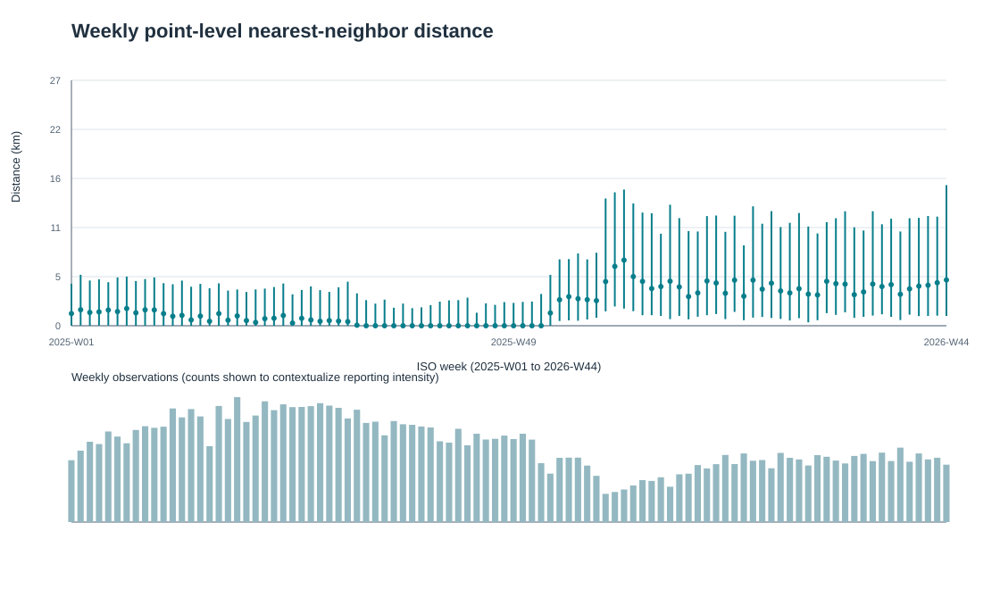
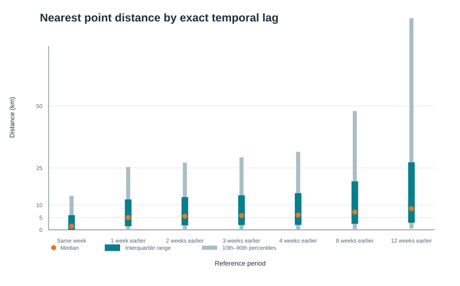
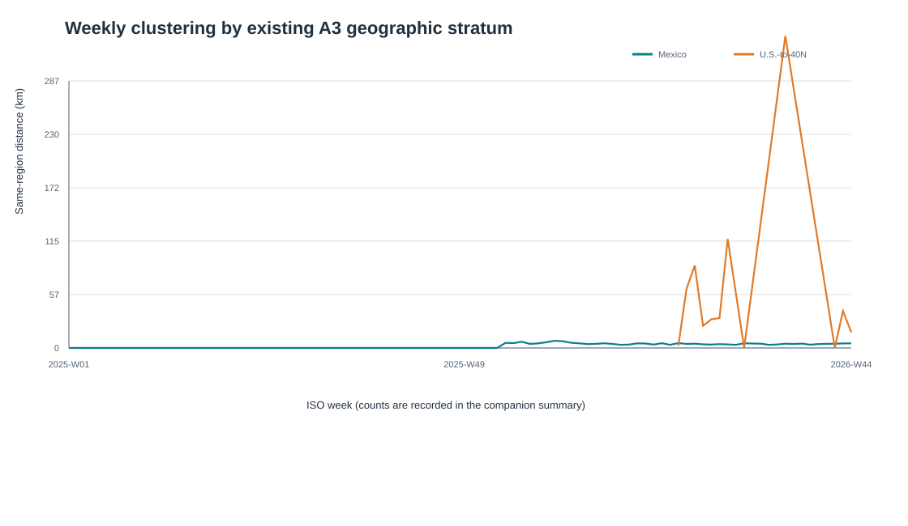

# STRUCTURED_A3 point-level spatiotemporal clustering report

Analysis completed 2026-11-22 for the corrected `STRUCTURED_A3_2026W44`
observation vintage. This is a descriptive feature-feasibility investigation.
No model was fit, and no A3 model, response, predictor, production, or
qualification artifact was changed.

## I. Governance and repository state

The work used the default HGE execution governance. The task explicitly
authorized this bounded Atlas analysis. The change is **Category D** because it
adds scientific spatial calculations and an Atlas execution path. It was
developed in an isolated branch from the verified consolidated W44 commit
`955ae4375043552457a3f052458e4f9115ce9095`:
`analysis/a3-point-spatiotemporal-clustering`.

The full point products remain on Atlas. The repository contains only analysis
code, methods, aggregate CSV/SVG products, and this report. The existing W44
qualification work was referenced and left unchanged. No package-wide tests,
model qualification workflow, challenger fit, or production run was performed;
the requested synthetic and data-integrity checks plus this complete
descriptive analysis were the scoped validation for this task.

## II. Observation source and spatial reference

The authoritative source was
`/project/disease_ecology/NWScrewworm/data/processed_data/case_detections/combined_clean_obs_2026-11-13.csv`.
Its SHA-256 matched the accepted value
`784168081cc1d3206f3537b8731994cbfc34be15be7c515fe06710d4ea9bdaac`. The
source has 164,767 records. The analysis retained 163,799 records through
2026-W44, including 44,907 records before 2025-W01 beginning in 2022-W06 for
historical features. The 968 records in W45–W46 were excluded. The primary
period contains 118,892 observations in 96 weeks.

The existing frozen A3 support was used: 10,037 model cells, 96 response
weeks, and nominal 25 × 25 km spacing (24.995 × 24.944 km from the existing
grid affine). The broader environment mask was not treated as the fitted
domain. Original supplied point coordinates were retained at their source
precision and transformed to the existing kilometre-based WGS84 Albers
Conic Equal Area CRS. Points were never snapped to cell centroids. A point
assigned to a model cell has zero point-to-footprint distance; its point to
centroid and distance to cell edge were calculated separately.

The affine crosswalk matched all 10,037 stored A3 cell centers with zero
residual. Reconstructed point-to-cell assignments reproduced the frozen
response exactly: 59,180 in-domain primary observations, 96 × 10,037 cell-weeks,
zero mismatched cell-weeks, and zero total count difference. In the full
through-W44 source, 59,184 records map to the fitted domain and 104,615 lie
outside it; for the primary period, 59,180 are in-domain and 59,712 are
outside.

The transformed stored node centroids differed from their stored projected
coordinates by at most 7.2 × 10⁻⁹ m. Rasterio/PROJ emitted a missing `proj.db`
warning, so a deterministic WGS84 ellipsoidal geodesic comparison was also run
on up to 1,000 nearest pairs per lag. Across those seven samples, median
absolute differences ranged from 0.003 to 0.040 km and the largest 95th
percentile absolute difference was 1.387 km. The largest 95th percentile
absolute relative difference was 1.45%; the largest relative difference was
7.59% for a short sampled pair. These checks support the regional-scale
projected distances while retaining the CRS distortion caveat for individual
short pairs. Input hashes are in the Atlas `analysis_manifest.json`; the
observation checksum and W44 integrity audit are also recorded in the existing
[corrected-source audit](../structured_a3_data_refresh_2026w44/observation_corrected_source_reaudit.md)
and [W44 input manifest](../structured_a3_data_refresh_2026w44/candidate_data_vintage_manifest.json).
The analysis-script SHA-256 for the final Atlas computation was
`9d46d3663ac801886f3fbafa33844b1f53fae3e23d97dd19f7c8e1d9b741d8da`, as
recorded in its Atlas manifest.

## III. Point-level within-week clustering

For every observation, the nearest *other record* in the same ISO week was
found using the original point coordinates. Distinct records with identical
coordinates remain valid zero-distance neighbours; the queried record itself
is excluded. All 118,892 observations had an eligible neighbour. Across the
96 weeks, weekly counts ranged from 447 to 1,982, and the median of weekly
median distances ranged from 0 to 7.31 km.

The pooled same-week nearest-neighbour distribution had mean 5.05 km,
standard deviation 10.16 km, median 1.45 km, 10th percentile 0 km, 25th
percentile 0 km, 75th percentile 5.92 km, and 90th percentile 13.72 km.
Nearest neighbours were within 1, 5, 10, and 25 km for 45.8%, 71.4%, 85.1%,
and 96.2% of observations, respectively. The zeros reflect distinct records
sharing a location, not self-matches. The source audit found no duplicate
`(date, longitude, latitude)` keys; locations can recur on different dates.

See the [96-week summary](results/weekly_nearest_neighbor_summary.csv).

## IV. Temporal-lag clustering

For each focal point, the reference was the nearest point from the exact
specified earlier week. These are fixed-lag comparisons, not cumulative
windows. Every lag had 118,892 defined comparisons and no undefined distances;
the pre-2025 source history supplies references for the start of the primary
period.

| Reference | Median km | 10th–90th percentile km | Within 25 km |
| --- | ---: | ---: | ---: |
| Same week | 1.45 | 0.00–13.72 | 96.2% |
| 1 week earlier | 5.00 | 0.00–25.36 | 89.8% |
| 2 weeks earlier | 5.50 | 0.01–27.14 | 88.7% |
| 3 weeks earlier | 5.77 | 0.06–29.29 | 87.4% |
| 4 weeks earlier | 5.95 | 0.10–31.54 | 86.2% |
| 8 weeks earlier | 7.17 | 0.33–48.04 | 80.0% |
| 12 weeks earlier | 8.54 | 0.52–85.56 | 73.5% |

Median and upper-tail distance increased with lag. This describes geographic
proximity among reports and does not measure movement or transmission.

The full table is [temporal-lag summary](results/temporal_lag_summary.csv).

## V. Regional variation

The existing node crosswalk supports `Mexico` and `U.S.-to-40N`. It did not
provide a separate frontier-status field, so no new boundary was introduced.
Of the primary in-domain observations, 59,082 were assigned to Mexico and 98
to the U.S.-to-40N stratum.

| Existing stratum | Primary observations | Weeks with a defined same-week NN | Median of weekly same-week medians (range), km |
| --- | ---: | ---: | ---: |
| Mexico | 59,082 | 96 | 0.00 (0.00–7.72) |
| U.S.-to-40N | 98 | 12 | 30.82 (0.00–335.26) |

Regional exact-lag summaries also show much sparser U.S. support. For the
1-week lag, 59,077/59,082 Mexico comparisons and 90/98 U.S.-to-40N comparisons
were defined; the median of weekly medians was 8.10 km in Mexico and 114.67 km
in the U.S.-to-40N stratum. At 12 weeks, 58,426/59,082 and 48/98 were defined,
with medians of weekly medians 20.46 and 233.57 km, respectively. U.S. values
are based on very few reports and should not be treated as a stable regional
contrast. No regional distance is interpreted as a physical movement
distance.

See [regional same-week](results/regional_clustering_summary.csv) and
[regional lag](results/regional_temporal_lag_summary.csv) summaries.

## VI. Sub-cell spatial structure

Within each multi-detection cell-week, point-level nearest-neighbour
distributions and pairwise-distance summaries were calculated. Exact
unique-pair distances were used through 50,000 pairs per cell-week; larger
groups would use a deterministic 50,000-pair sample with replacement. In
this data, **all 12,420 multi-detection cell-weeks were summarized exactly**:
144,964 within-cell pairs in Mexico and 39 in U.S.-to-40N, with no sampled
cell-week.

Across weeks, the median of the weekly medians of cell-week pairwise medians
was 3.94 km in Mexico and 4.17 km in U.S.-to-40N. The corresponding median of
weekly medians of cell-week maximum separation was 5.91 and 5.14 km. These
values summarize cell-week distributions; they are not a pooled point-pair
median. The [within-cell table](results/within_cell_distance_summary.csv)
contains weekly nearest-neighbour summaries, the number of unique pairs, and
the pairwise exactness flags.

For pairs under 5, 10, and 25 km within the fitted domain, respectively, the
analysis found 60,340, 112,424, and 296,187 unique pairs. The fractions crossing
cell boundaries were 8.2%, 19.2%, and 51.5%. The 25 km result is especially
relevant to a nominal 25 km grid: close pairs occur on both sides of cell
edges, so a single cell’s count does not preserve their sub-cell arrangement.

## VII. Information loss from 25 km aggregation

Across the primary fitted domain there were 21,654 occupied cell-weeks, of
which 12,420 (57.4%) contained multiple observations. Those cell-weeks
contained 49,946 of 59,180 observations (84.4%). The occupied-cell-week
detection-count distribution was 9,234 with one record, 5,524 with two,
2,047 with three, 1,700 with four, 788 with five, and 2,361 with six or more.
The mean was 2.73 detections per occupied cell-week; the maximum was 60.

For observations within 5 km of an edge, Mexico had 36,982 such observations
and 9,107 defined nearest neighbours in another cell. Among those cross-cell
pairs, centroid separation overstated actual point separation for 87.4%; it
overstated by at least 5 km for 78.2%, by at least 10 km for 66.0%, and was at
least twice the point distance for 51.2%. The median across weekly median
point distances was 12.47 km, compared with 25.00 km for the corresponding
cell centroids; the median of weekly median overstatements was 14.62 km.

The U.S.-to-40N stratum had 55 near-edge observations but only 32 defined
cross-cell neighbours. Its overstatement rate was 56.2%, a low-support result.
The detailed geographic example
`point_nearest_neighbor_at_cell_boundary.svg` is retained with the detailed
Atlas outputs because it displays point locations. Aggregate tables are in
[`between_cell_proximity_summary.csv`](results/between_cell_proximity_summary.csv)
and [`short_distance_pair_summary.csv`](results/short_distance_pair_summary.csv).

These results quantify information discarded by cell-week aggregation. They
do not establish that the existing grid or production model is defective:
cell-week counts still represent report intensity, and no model comparison
was part of this analysis.

## VIII. Historical proximity feature definitions

Each of the 10,037 model-cell centroids was an evaluation location. Reference
points used original coordinates from completed weeks strictly before the
target week. Windows were the prior 1, 3, 8, and 12 complete ISO weeks, with a
nearest-point distance calculated both including all points and excluding
points assigned to the focal cell. Previous-12-week concentration counts
within 25 and 50 km distinguished point records, distinct source-coordinate
locations, and distinct A3 cells.

| History window | Eligible point records per target week, min–max | Availability |
| --- | ---: | --- |
| Previous 1 week | 447–1,982 | All 96 weeks |
| Previous 3 weeks | 1,441–5,572 | All 96 weeks |
| Previous 8 weeks | 4,611–14,780 | All 96 weeks |
| Previous 12 weeks | 7,765–21,853 | All 96 weeks |

All 963,552 cell-weeks had defined values for the new distance and
concentration features. The feature panel recorded zero cases where the
history cutoff reached the target week or later. The final Atlas detail file
also records each week’s eligible observation count, cutoff, and lookback.

Across all cell-weeks, nearest-any-point distance had median 1,380.65 km and
10th–90th percentile 83.09–2,368.96 km for the prior-week window. For the
12-week window the median was 1,269.35 km and the 10th–90th percentile was
45.42–2,262.02 km. Focal-cell exclusion changed the landscape-wide medians
very little: 1,380.65 km for the prior-week window and 1,269.35 km for the
12-week window. The closer local tails remain represented in the full
[feature inventory](results/historical_proximity_feature_inventory.csv).

The 12-week, 25 km point-record count had median 0, 90th percentile 0, mean
2.02, and maximum 648 records per centroid. At 50 km, its median was 0, 90th
percentile 1, mean 7.58, and maximum 1,156. The 25 km distinct-location count
had maximum 391 and the distinct-cell count maximum 9; at 50 km those maxima
were 543 and 21. These are highly concentrated tails over many zero-valued
cell-weeks.

## IX. Relationship with existing A3 history predictors

The corrected comparison joined the W44 frozen history panel on its unique
ISO-week and model-cell keys. The stored `week_index` was not used as a join
key because the source panels use different index codings. The join guard
verified complete key matches and finite values in all comparison fields.

Across all 963,552 cell-weeks, the new nearest-history distance features had
Spearman correlations of 0.99–1.00 with the most similar existing A3 distance
predictor (`distance_to_prev4_positive_log1p` or
`distance_to_any_prior_positive_log1p`); the corresponding Pearson
correlations were 0.75–0.77. The absolute Spearman correlations for the
distance-to-distance comparisons ranged from 0.96 to 1.00 across the
region- and year-specific diagnostics.

The new 12-week concentration counts were also strongly rank-associated with
the existing `weeks_since_detection_within_50km_log1p` feature. In the full
panel, 25 km record, location, and cell counts each had Spearman rho near
−0.88; the corresponding 50 km counts each had rho near −0.97. Across region
and year scopes, absolute rho ranged from 0.52–0.88 at 25 km and 0.81–0.97 at
50 km. This leaves some difference in the count features’ magnitude, but the
rank patterns largely follow the frozen recency predictor. Correlation tables
include Pearson and Spearman values by region and year in
[`feature_redundancy_correlations.csv`](results/feature_redundancy_correlations.csv).

Feature distributions varied geographically and over time. For the
prior-week nearest point, the median was 453 km in Mexico and 1,638 km in
U.S.-to-40N. For the 12-week nearest point, regional medians were 333 and
1,524 km. The 25 and 50 km point-count medians and 90th percentiles in the
U.S.-to-40N stratum were all zero. The prior-week distance median was 1,715 km
in 2025 and 987 km in 2026; the corresponding 12-week medians were 1,573 and
902 km. These contrasts can arise from the changing opportunistic reporting
pattern and geography, and do not isolate underlying ecological change.

## X. Descriptive nonlinear relationships

The table below relates target-week response counts to prior-week
nearest-history distance at the A3 centroid. The feature ends before the
target week, and no response value was used to construct it. Cell-weeks with
missing history were absent from this run.

| Prior-week distance, km | Cell-weeks | Occurrence rate | Mean count incl. zeros | Mean count when positive |
| --- | ---: | ---: | ---: | ---: |
| <1 | 240 | 69.2% | 3.25 | 4.70 |
| 1–5 | 4,304 | 65.0% | 3.00 | 4.61 |
| 5–10 | 8,487 | 54.7% | 1.84 | 3.37 |
| 10–25 | 29,192 | 29.6% | 0.69 | 2.33 |
| 25–50 | 33,110 | 11.7% | 0.22 | 1.87 |
| 50–100 | 27,254 | 4.7% | 0.08 | 1.65 |
| 100–250 | 33,732 | 0.7% | 0.01 | 1.51 |
| 250+ | 827,233 | 0.002% | 0.00004 | 1.94 |

Occurrence and mean count declined across wider distance bins. The large
250+ group also shows how much of the fitted grid-week panel is remote from
the recent report history. This association is descriptive and may reflect
the same reporting geography represented by existing A3 history predictors;
it is not a causal effect, spatial covariance function, or evidence of
incremental model value.

See the [full distance-bin table](results/response_associations_by_distance_bin.csv)
and [feature distributions by region, year, and week](results/historical_feature_distribution_by_group.csv).

## XI. Computational feasibility

The final job (`21305706`) ran on one Atlas development node with 4 CPUs,
requested 32 GiB, and used the existing STGNN Python bootstrap. Peak process
RSS was about 6.1 GiB; the launcher’s memory request is now 16 GiB, leaving
about 2.6× measured headroom for a rerun. The analysis
script’s measured elapsed time was 160.3 seconds; Slurm wall time was 2 minutes
57 seconds. Peak process RSS was 6,348,656 KiB (about 6.1 GiB). It processed
118,892 primary observations, emitted 832,244 point-lag rows, and constructed
963,552 cell-week features. The runtime was Python 3.12.14, NumPy 2.5.3,
pandas 3.0.6, SciPy 1.18.1, Rasterio 1.5.2, and PyArrow 25.0.1.

Nearest-neighbour calculations used KD-trees. Within-cell threshold pair
counts used spatial-tree counts; pairwise summaries were exact in this data,
and the deterministic sampling path was synthetically verified. No complete
observation-by-observation matrix or dense cell-by-point matrix was created.
Focused validation and execution-resource records are retained under the
Atlas output root below.

## XII. Opportunistic-reporting limitations

These reports are opportunistic observations. Their spatial distribution can
reflect reporting effort, repeated accessible locations, local persistence,
and the underlying phenomenon; these mechanisms are not separately
identified. The source has observation dates but no release timestamps.
Therefore C features are retrospective revised-vintage history and cannot be
claimed to have been available at an operational issue time. No prospective
forecasting claim is made. W45–W46 are excluded from the W44 analyses and
features.

Nearest-neighbour distances are not movement, dispersal, transmission, or
causal influence distances. Weekly nearest-neighbour values can also decline
when reporting volume increases, so weekly observation counts accompany the
summaries.

## XIII. Scientific interpretation

1. **How much clustering is below 25 km?** The same-week nearest neighbour
   was within 25 km for 96.2% of all primary-period observations. Sub-cell
   pair counts and exact within-cell summaries show substantial local
   structure.
2. **How does proximity vary with time?** The pooled median increased from
   1.45 km in the same week to 5.00 km at one week and 8.54 km at twelve weeks;
   73.5% of twelve-week exact-lag neighbours remained within 25 km.
3. **How much information is lost by cell-week aggregation?** 84.4% of
   in-domain point observations came from multi-detection cell-weeks, 51.5%
   of point pairs under 25 km crossed cell boundaries, and near-edge cell
   centroids often overstated actual cross-cell separation.
4. **Do the new historical features differ from frozen A3 history?** Nearest
   distances were nearly perfectly rank-correlated with existing distance
   predictors. Local count features varied in magnitude but had strong rank
   association with the existing 50 km recency feature. Response-bin curves
   follow the same broad recent-history gradient.
5. **Is a constructed-covariate challenger justified?** The findings show
   sub-cell structure, but do not show that these summaries supply enough
   independent, issue-time-available information to justify a challenger.

The results quantify a real representational difference between point
coordinates and cell-week counts. That difference alone does not establish
incremental scientific or predictive value beyond the frozen A3 history
predictors.

## XIV. Repository and pull-request status

The isolated branch is
`analysis/a3-point-spatiotemporal-clustering`, based on the consolidated W44
refresh. Aggregate summaries, analysis code, this report, and summary figures
are the repository deliverables. Point assignments, point distances,
cell-week feature panels, and the point-level boundary map are held only at
`/project/disease_ecology/STGNN-output/a3_point_spatiotemporal_clustering_w44_history_join`
on Atlas. A draft PR targets
`analysis/structured-a3-2026w44-refresh`; no merge was performed, and PRs #31,
#34, and #35 were not modified.

## XV. Final exploratory decision

**`POINT_PROXIMITY_CHALLENGER_NOT_JUSTIFIED`**

The data show strong point-level clustering and clear sub-cell geometry that
the 25 km cell-week table cannot retain. The constructed history distances,
however, are almost perfectly rank-correlated with frozen A3 history-distance
predictors, and the concentration counts largely follow the existing
50 km-recentness ranking. The response-bin gradient is descriptive and does
not establish incremental value. With no independent prospective release-time
history, the evidence from this bounded analysis does not meet the task’s
requirement for potentially useful additional information. No challenger was
fit or selected.
